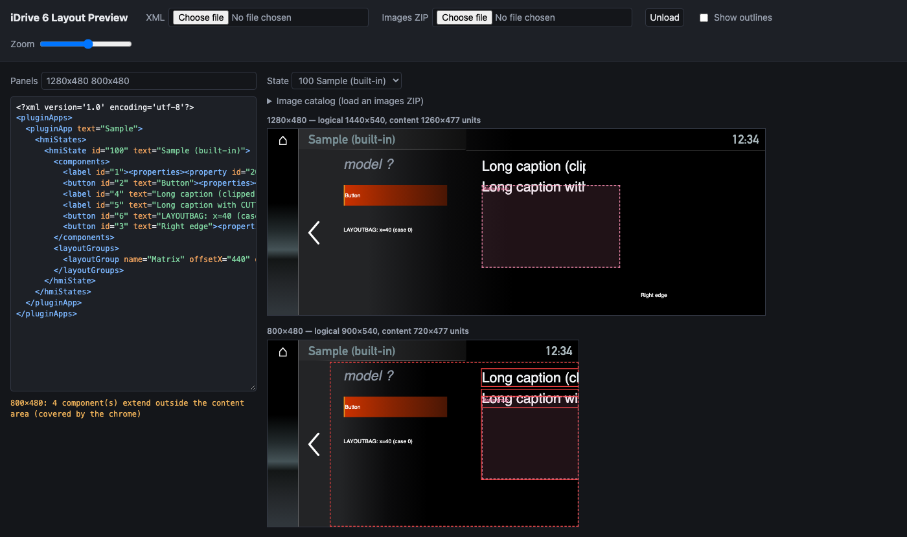
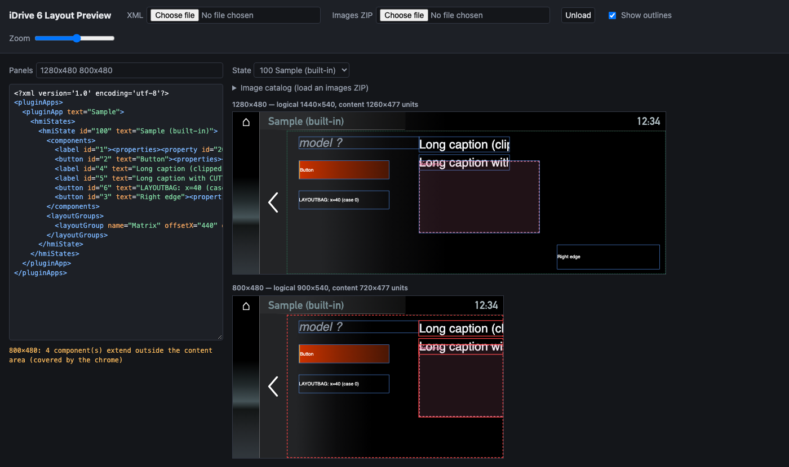

# iDrive 6 Layout Preview

A single-page tool that draws the screens (`hmiState`s) of an iDrive 6 plugin app straight from its XML manifest, at several panel sizes at once. You can see how a layout lands on a 800×480, 1280×480 or 1920×720 screen without a car or an emulator.

**Live:** <https://andreas.boehm.cx/idrive6-layout-preview/>

It is an approximation built from measurements, not the real HMI renderer. See [Limits](#limits).

Not affiliated with or endorsed by BMW. No BMW code, fonts or graphics are included.

## Use it

No server, no build, no install.

1. Open `index.html` in a browser, or the published GitHub Pages site. A built-in sample loads first.
2. Pick a plugin manifest with **XML**, or paste the XML into the editor. Your edits redraw live.
3. Optional: load the matching `*_ALL_Images.zip` with **Images ZIP** so `image` components show their real pictures.
4. Choose a **State** (an `hmiState`). States that have an option menu appear twice: once plain and once with `+ options menu`.
5. Adjust the view:
   - **Panels**: space-separated `WxH` list, for example `800x480 1280x480 1920x720`.
   - **Show outlines**: draws a box around every component and the content area.
   - **Zoom**: preview scale.

   Components that overflow the content area always get a red outline, and the content box turns red, with or without outlines.

   

6. Read the warning box under the editor. It lists things the preview cannot draw or that the HMI would reject.
7. **Image catalog** (collapsible) shows every image in the ZIP with its id and size. You can filter it by id or to the images the current state uses.
8. **Unload** returns to the sample.

Everything stays in your browser. Your last XML, ZIP and settings are stored in IndexedDB so a reload restores the session.

All files are plain HTML, CSS and JS (`index.html`, `style.css`, `app.js`), so it also works when opened directly from disk.

## How layouting in iDrive 6 works

This is what the preview assumes. It was reverse-engineered from the plugin XML format and checked against screenshots, so treat it as measured behavior and not as documentation.

### The XML

A plugin manifest contains `pluginApp` → `hmiStates` → `hmiState`. One `hmiState` is one screen. It has:

- `components`: `label`, `button`, `image` and `widget` elements. Each has a `properties` list of `property id="…" value="…"`.
- `optionComponents`: the entries of the option menu (the native list that slides in on the left).
- `layoutGroups`: slots (`Matrix`, `Bar`, `List`) that arrange native elements.
- `imageIdModel` elements, which map an image model id to an image id. The image id is the number at the end of a PNG name in the images ZIP.

Properties used for geometry:

| id | meaning |
|----|---------|
| 20 | x |
| 21 | y |
| 9 | width |
| 10 | height |
| 3 | visible (`false` hides the component) |

A property can carry a `<condition conditionType="LAYOUTBAG">` with per-case values. The preview uses cases 0 and 2. What the other cases mean (for example split-screen) is not known yet.

### Design units and scaling

**The base for all layouts is 1440×540 units.** Plugin XML is written in this space: x, y, width and height are design units on a 1440×540 canvas, not pixels.

The HMI maps that canvas onto the real panel. The logical canvas is always **540 units high** and `540 × W / H` units wide, and it is scaled uniformly by `s = H / 540`, so nothing stretches:

| panel | logical canvas | s |
|-------|----------------|---|
| 1280×480 | 1440×540 | 0.889 |
| 1440×540 | 1440×540 | 1 |
| 1920×720 | 1440×540 | 1.333 |
| 960×480 | 1080×540 | 0.889 |
| 800×480 | 900×540 | 0.889 |

Every panel with an 8:3 aspect ratio (1280×480, 1920×720, 1440×540) gives exactly 1440×540. Narrower panels (960×480, 800×480) have less room on the right (1080 and 900 units wide), but the same height.

All coordinates in the XML are in these units. Pixel position = `origin + value × s`.

### Chrome and content area

Part of the canvas is taken by the system chrome. In design units:

- the title bar is 63 high,
- the edge strip is 81 wide (with the home icon),
- a back-arrow column runs up to x=180.

Your components live in the **content area**. Its origin is at (180, 63), it is 477 units high, and it runs to the right edge of the canvas. So its width is the logical canvas width minus 180:

| panel | logical canvas | content area (w × h) |
|-------|----------------|----------------------|
| 1280×480, 1440×540, 1920×720 | 1440×540 | 1260×477 |
| 960×480 | 1080×540 | 900×477 |
| 800×480 | 900×540 | 720×477 |

Component coordinates are relative to the content area's origin, so x=0 is at canvas x=180 and the widest usable x on a 1440-wide canvas is 1260.

Anything you place outside the content area is covered by the chrome. The preview marks it and warns.

### Components

- **Images** are cropped to their box and not resized. The picture keeps its own pixel size scaled by `s`.
- **Labels** have no font property. They use the regular label font (40 units). Text is left-aligned, vertically centered, and hard-clipped at the label's width with no ellipsis. The `CUTTYPE` (37) and `ALIGNMENT` (17) properties had no visible effect in the measurements.
- **Widgets** (`widgetName="LT_…"`) pick a built-in template by name, which decides font size, color and alignment. The sizes the preview knows are in the `TPL` table in `app.js`. A `FontSize` binding to a text model gave one fixed size (36 units) regardless of the value.
- **Buttons** are drawn as boxes. The first one gets the "focused" highlight.
- **Components without x/y/width/height** are placed by the HMI itself. The preview shows them as stacked placeholders, and the real positions will differ.
- **Option-menu entries** are native and not part of the canvas. They are drawn as a list over the left side when you pick the `+ options menu` state.
- **layoutGroups** are drawn as dashed boxes. The preview warns about an invalid slot name, unsupported `element*` attributes, alignment values the HMI ignores, and a zero Matrix cell size.

## Open questions

- **How a layout reacts to a smaller screen.** The canvas is 540 units high everywhere, but it is narrower on small panels: 1440 wide on 1280×480, 1080 on 960×480 and 900 on 800×480. Absolute x/y/width/height values do not change, so a component placed for 1440 can end up outside the content area on a smaller panel. The preview shows this as a red outline.
  What is not known is how a plugin is meant to adapt:
  - What `LAYOUTBAG` conditions select. The preview only uses cases 0 and 2, and it is not known whether other cases are chosen by panel width, by split-screen, or by something else.
  - Whether `layoutGroup` slots (`Matrix`, `Bar`, `List`) reflow native elements to the available width, and how.
  - Whether the HMI scales, clips or repositions components that do not fit.
- **Split-screen.** How it changes the content area is not known, so it is not drawn.

## Limits

- It is an approximation. Fonts are not the real ones (the preview falls back to common system fonts), so text widths differ a little.
- The chrome (title bar, home strip, clock, back arrow) and the HMI look are an imitation for orientation only.
- The geometry rules come from measurements with an emulator and real screenshots at 1280×480 and 800×480. Other sizes follow the same scaling rule but are less checked.
- Components without absolute geometry, option menus and layoutGroup contents are placeholders, not real native layouts.
- Unknown `LT_` widgets are drawn as regular labels and flagged.
